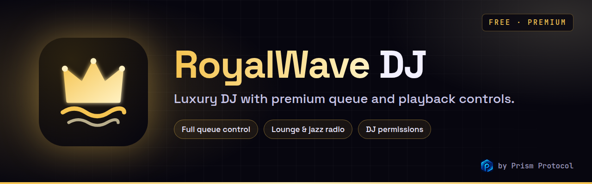

<div align="center">




# RoyalWave DJ

**Luxury DJ with premium queue and playback controls.**

A luxury-styled Discord DJ bot with a refined queue (move, jump, remove, shuffle), DJ role permissions, lounge and jazz radio, and a live web dashboard.

[](https://krishyaa06.github.io/prism-bots-panel/#/bot/royalwave)
[](https://krishyaa06.github.io/prism-bots-panel/#/dashboard/royalwave)
[](https://krishyaa06.github.io/prism-bots-panel/#/premium/royalwave)
[](https://dc.gg/prismprotocol)


</div>


## ✨ Why RoyalWave

- **Full queue control: /move, /skip to:, /remove, /shuffle, /clear**
- **Lounge & jazz radio: Secret Agent, Sonic Universe, Illinois Street Lounge, Bossa Beyond**
- **Concert Hall filter and volume up to 200% with Premium+**
- **SoundCloud search** — type a song name and it just plays
- **One-tap controls** — pause, skip, loop, shuffle and stop buttons on every now-playing card
- **Web dashboard** — change settings, see what's playing and redeem Premium from the [Prism Bots Panel](https://krishyaa06.github.io/prism-bots-panel/#/dashboard/royalwave)
- **Free forever** — the core player never goes behind a paywall

## 🎛️ Commands

<details open>
<summary><b>🎵 Music</b></summary>

| Command | What it does |
| --- | --- |
| `/clear` | Clear upcoming tracks (keeps the current one) |
| `/leave` | Disconnect from the voice channel |
| `/loop` | Loop the track, the whole queue, or turn looping off |
| `/move` | Move a track to another queue position |
| `/nowplaying` | Show the current track with controls |
| `/pause` | Pause the current track |
| `/play` | Play a song: name (SoundCloud search), SoundCloud link, audio link or station |
| `/queue` | Show the queue |
| `/radio` | Tune in to a CosmicMix 24/7 radio station |
| `/remove` | Remove a track from the queue |
| `/resume` | Resume playback |
| `/seek` | Jump to a time in the current track |
| `/shuffle` | Shuffle the queue |
| `/skip` | Skip the current track (or jump to a position) |
| `/stop` | Stop playback and clear the queue |
| `/volume` | Set the volume (Free: up to 100, Premium: up to 200) |

</details>

<details>
<summary><b>💎 Premium</b></summary>

| Command | What it does |
| --- | --- |
| `/247` | Keep the bot in voice 24/7, even when the queue ends 💎 |
| `/autoplay` | When the queue ends, keep playing your favourite station 💎 |
| `/filter` | Apply an audio effect: bass boost, nightcore, 8D, lo-fi and more 💎 |
| `/playlist` | Save and load server playlists 💎 |
| `/premium` | See this server’s plan and what Premium unlocks |
| `/redeem` | Redeem a Premium key for this server |
| `/genkey` | Owner only: create Premium keys to sell or gift |

</details>

<details>
<summary><b>🛠️ Utility</b></summary>

| Command | What it does |
| --- | --- |
| `/help` | Everything CosmicMix can do |
| `/invite` | Add CosmicMix to another server |
| `/ping` | Check latency |
| `/settings` | Configure the bot for this server (or use the web panel) |
| `/stats` | Bot statistics |

</details>

💎 = needs Premium on the server.

## 📻 Radio stations

| Station | Vibe | Command |
| --- | --- | --- |
| Secret Agent | Spy lounge | `/radio station:secretagent` |
| Sonic Universe | Jazz | `/radio station:sonicuniverse` |
| Illinois Street Lounge | Classic lounge | `/radio station:illstreet` |
| Bossa Beyond | Bossa nova | `/radio station:bossa` |
| Left Coast 70s | 70s soft rock | `/radio station:seventies` |

Radio streams come from [SomaFM](https://somafm.com), listener-supported and commercial-free. Please consider [supporting them](https://somafm.com/support/).

## 💎 Premium

RoyalWave is free. Premium is per server and unlocks the extras that cost more to run.

| | Free | Premium | Premium+ |
| --- | :---: | :---: | :---: |
| Price | ₹0 | **₹99/month** · ₹999/year | **₹249/month** · ₹2,499/year |
| Queue size | 100 | 500 | 2,000 |
| Max volume | 100% | 150% | 200% |
| Audio filters | — | ✅ | ✅ |
| 24/7 mode | — | ✅ | ✅ |
| Autoplay radio | — | ✅ | ✅ |
| Saved playlists | — | 10 × 200 tracks | 50 × 1,000 tracks |

**Prism Pass — ₹399/month · ₹3,999/year:** Premium+ on all five Prism music bots (CosmicMix, EchoArena, Midnight Vibes, NeonPulse, RoyalWave) for one server.

Filters: 🔊 Bass Boost · 🌙 Nightcore · 🌴 Vaporwave · 🎧 8D Audio · 📼 Lo-Fi · 🎤 Karaoke · ✨ Treble · 🏟️ Concert Hall · 🌫️ Slowed + Reverb

### How to get it

1. Pick a plan on the [Premium page](https://krishyaa06.github.io/prism-bots-panel/#/premium/royalwave).
2. Pay through the link there, or open a **Premium** ticket in the [Prism Protocol Discord](https://dc.gg/prismprotocol) (UPI and cards accepted).
3. You get a key like `RYW-XXXX-XXXX-XXXX`. Run `/redeem key:<your key>` in your server, or paste it in the dashboard's 💎 Premium tab.

Time stacks: redeeming another key on the same plan extends it.

## 🚀 Self-host

You need **Node.js 18.17+** and a bot application from the [Discord Developer Portal](https://discord.com/developers/applications). FFmpeg is bundled through `ffmpeg-static`, nothing else to install.

```bash
git clone https://github.com/krishyaa06/royalwave-dj-bot.git
cd royalwave-dj-bot
npm install
cp .env.example .env      # add DISCORD_TOKEN and CLIENT_ID
npm run deploy            # registers slash commands
npm start
```

| Variable | Required | Notes |
| --- | :---: | --- |
| `DISCORD_TOKEN` | ✅ | Bot token |
| `CLIENT_ID` | ✅ | Application ID |
| `OWNER_IDS` | | Your Discord user ID(s), comma separated. Owners can run `/genkey` |
| `GUILD_ID` | | Register commands instantly in one test server |
| `PANEL_API_PORT` | | Port for the web dashboard API, `0` = off |
| `PANEL_ORIGIN` | | Allowed dashboard origin (default `https://krishyaa06.github.io`) |
| `PREMIUM_BUY_URL` | | Where the "Buy Premium" buttons point |
| `SOUNDCLOUD_CLIENT_ID` | | Fixed SoundCloud client id (otherwise fetched automatically) |
| `BOT_DATA_DIR` | | Where settings, keys and playlists are stored (default `./data`) |

In the Developer Portal, the bot needs no privileged intents. Invite it with the `bot` and `applications.commands` scopes.

### Selling Premium

```text
/genkey tier:Premium days:30 count:5
```

The keys are shown only to you (ephemeral reply). Only a SHA-256 hash is stored, so a leaked data file can't be turned back into working keys.

## 🌐 Web dashboard

The [Prism Bots Panel](https://krishyaa06.github.io/prism-bots-panel/) is a static site that talks to a small API built into the bot.

1. Set `PANEL_API_PORT=8080` (any free port) and start the bot.
2. Put it behind HTTPS, e.g. Caddy: `royalwave.example.com { reverse_proxy localhost:8080 }`, or a Cloudflare Tunnel.
3. In the panel repo, edit `js/config.js`: set `bots.royalwave.apiUrl` to that HTTPS URL and `bots.royalwave.clientId` to your application ID. Add the panel URL as an OAuth2 redirect in the Developer Portal.

Users log in with Discord (`identify guilds` scope). The API checks **Manage Server** on every request, so people can only change servers they manage.

## 🔒 Sources and safety

- Plays SoundCloud, SomaFM radio and direct audio links.
- YouTube and Spotify are blocked on purpose: streaming them breaks their terms and gets public bots taken down.
- Direct links are checked against private and internal IP ranges before anything is fetched.

## 🗂️ Project structure

```text
royalwave-dj-bot/
├── bot.config.js          # name, colours, emoji, statuses, radio stations
├── src/
│   ├── index.js           # client, events, panel API
│   ├── deploy-commands.js
│   ├── commands/          # music · premium · utility
│   ├── events/            # ready · interactionCreate · voiceStateUpdate
│   └── lib/               # player, premium keys, settings, filters, sources, panel API
├── assets/                # logo, banner, Discord avatar + profile banner
├── scripts/check.js       # loads every command and validates it
└── test/                  # node --test
```

```bash
npm test        # unit tests
npm run check   # command sanity check
```

## 🎨 Branding

Logo, banner, Discord avatar and the "About me" text are in [`assets/`](assets) and [`BRANDING.md`](BRANDING.md).


<div align="center">

**More Prism bots:** [CosmicMix](https://github.com/krishyaa06/cosmicmix-dj-bot) · [EchoArena](https://github.com/krishyaa06/echoarena-player) · [Midnight](https://github.com/krishyaa06/midnight-vibes-bot) · [NeonPulse](https://github.com/krishyaa06/neonpulse-music-bot)

Built by [Soumya Bhandare](https://github.com/krishyaa06) · [Prism Protocol](https://dc.gg/prismprotocol) · MIT License

</div>
